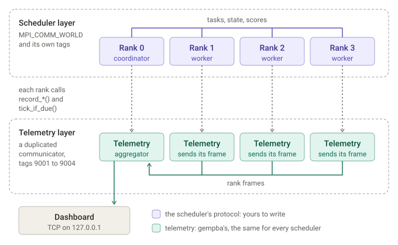

# Feeding telemetry from a custom scheduler

A scheduler passed to `gempba::mpi::create_scheduler(std::unique_ptr<scheduler>)` gets telemetry the same way the built-in schedulers do. What reaches the dashboard depends on the rules below. The words rank, coordinator, worker, aggregator and sentinel mean what [the wire format's vocabulary](wire-format.md#vocabulary) says.

## What your scheduler implements

Every rank calls `scheduler::run(node_manager, runnables, seed)`, and only the root, rank 0, passes the seed. `run`, `get_result()` and `get_all_results()` check that rule and the root before they reach your scheduler (#394). Your scheduler implements:
- `do_run(node_manager&, runnables, std::optional<task_bundle> seed)`: this rank's part of the run, returning how it ended once the whole run has ended. The seed is set exactly on the root. Whether the root also runs tasks is up to your scheduler; the built-in ones keep it as their coordinator. See [Stopping early](#stopping-early) for the `run_outcome` it returns.
- `do_get_result()` and `do_get_all_results()`: the best result, and each rank's, which the root reads after `run`.
- `force_push(task, runnable_id)` and `try_open_transmission_channel()`: how the load balancer hands a task to another rank.
- The rest of `scheduler`: `barrier()`, `rank_me()`, `world_size()`, the stats calls, `set_goal()` and `set_custom_initial_topology()`.

## Stopping early

A run stops early when the program calls `gempba::request_stop()` or when `SIGINT` or `SIGTERM` arrives (#465). The load balancers already prune every node that hasn't started on a rank that sees the stop. Your scheduler:
- Polls `gempba::stop_requested()` in its loops and tells the other ranks, so ranks that saw no signal stop too.
- Runs no task it receives after the stop, and still acknowledges it, so termination detection completes as usual.
- Returns the same `run_outcome` from `do_run` on every rank: `end_reason::INTERRUPTED`, with the trigger and signal of the stop the root acted on, once a stop was requested on any rank before the run ended; `end_reason::COMPLETED` otherwise.

## Two layers over the same ranks



- **The scheduler layer is yours.** It runs on `MPI_COMM_WORLD` with your own tags: tasks, state reports, scores, whatever your protocol needs.
- **The telemetry layer is gempba's,** and it's the same for every scheduler. It runs on a duplicated communicator with its own tags (9001 to 9004), so neither layer can match the other's receives. Every rank sends its frame to the aggregator, rank 0, which serves the stream on `127.0.0.1`.
- **The two layers meet only where your scheduler calls `gempba::telemetry::get()`.** It reports what happens with the `record_*()` calls, and drives telemetry with `tick_if_due()`.

## Rules

1. **Create the scheduler on every rank.** `create_scheduler` installs the telemetry hub, which duplicates a communicator and gathers the topology. Both steps are collective, so a rank that skips them deadlocks the others. To run without telemetry, call `gempba::telemetry::disable()` on every rank before any `create_*` call.
2. **`rank_me()` is the `MPI_COMM_WORLD` rank, and `world_size()` its size.** Telemetry addresses ranks by them.
3. **Tick from your own loops.** Under MPI, telemetry has no thread of its own. MPI runs `MPI_THREAD_FUNNELED`, so only the thread that makes your MPI calls may drive it.
   - Call `tick_if_due()` in every loop that can run for long, busy-waits included. When nothing is due, it returns after one clock comparison.
   - The aggregator reads the other ranks' frames only while rank 0 ticks, so rank 0 must keep ticking until the run ends.
4. **Shut down on every rank.** `gempba::shutdown()` sends each rank's final frame. The aggregator waits up to one second for the final frames, then sends the line marked `"final":true`.
5. **Say who coordinates.**
   - Override `role_of(int)` to return `rank_role::COORDINATOR` for a rank that hands out work and runs no tasks. By default every rank is a worker.
   - Each rank reports its own answer, `role_of(rank_me())`, once at startup, so the answer must stay fixed for the run (#394).
   - Override `get_name()` to name your scheduler in the stream's `run.scheduler`. The default is `"custom"`.
6. **Report what happens with `record_*()`.** Each call is cheap and safe from any thread. `get()` returns `nullptr` when telemetry is off, so guard every call:
   ```cpp
   if (auto* v_telemetry = gempba::telemetry::get()) {
       v_telemetry->record_send(v_destination, v_bytes, v_elapsed);
   }
   ```

## Which call fills which key

| Call | Fills | When |
|---|---|---|
| `record_send(rank, bytes, elapsed)` | `tasks_sent_total`, `bytes_sent_total`, `send_microseconds_total`, and the `edges_out` entry for that rank | After sending a task to another rank, with the bytes sent and how long the sends took |
| `record_recv(rank, bytes, elapsed)` | `tasks_recv_total`, `bytes_recv_total`, `recv_microseconds_total` | After receiving a task from another rank |
| `record_run_start()`, `record_run_end()` | The run's start and end. The `_ms` keys count from the start, and scheduler times stop accruing at the end | At the start and end of your scheduler's run |
| `record_worker_waiting()`, `record_worker_running()` | `sched_waiting_microseconds`, `sched_running_microseconds`, `first_task_ms`, `last_task_ms` | When a worker starts waiting for a task (at run start, and after it reports available), and when it gets one |
| `record_assignment(rank)`, `record_assignment_accepted(rank)` | `assign_latency_microseconds_total`, `assign_latency_microseconds_max`, `assign_count` | When the coordinator assigns a rank, and when that rank reports running |
| `record_coordinator_queue(available, queue_empty)` | `available_microseconds_queue_empty` | After the coordinator handles an event, with how many ranks are available and whether its queue is empty |
| `record_coordinator_state_msg()` | `coordinator_state_msgs_total` | For each running or available report the coordinator handles |
| `record_coordinator_score_proposal()` | `coordinator_score_proposals_total` | For each score proposal the coordinator receives |
| `record_coordinator_score_broadcast()` | `coordinator_score_broadcasts_total` | For each global score the coordinator broadcasts |
| `record_global_score_improved()` | `last_score_improvement_ms` | When the global score improves |
| `record_coordinator_full()`, `record_coordinator_free()` | `coordinator_full_microseconds` | When the coordinator tells its workers it is full, and when it has room again |
| `record_score_proposal_sent()` | `score_proposals_sent` | When a worker proposes its best score to the coordinator |

gempba fills everything else in a rank frame:
- `tasks_started_total` and the pool keys come from the load balancer;
- `scheduler_pending_count` comes from your `get_pending_request_count()`;
- the process and host figures come from telemetry's probes;
- `telemetry_microseconds_total` comes from the hub itself.

## A key you don't fill reads 0

- A scheduler that never makes a call leaves that call's keys at 0. A consumer treats a key that stays 0 for the whole run as nothing to show.
- There is no list of counters to declare: the `record_*()` calls are the declaration, so it can't drift from what your scheduler does (#392).
- Keep it that way. A scheduler reports what happens only through these calls, and the scheduler interface carries no telemetry bookkeeping.
